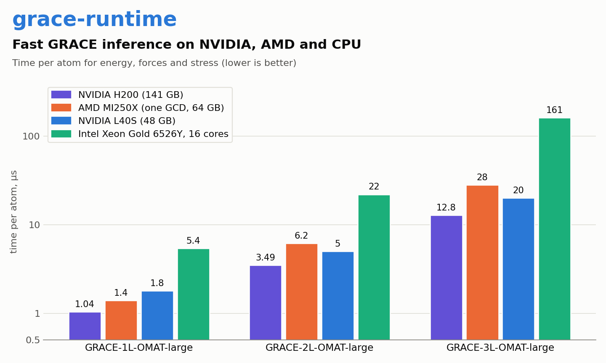
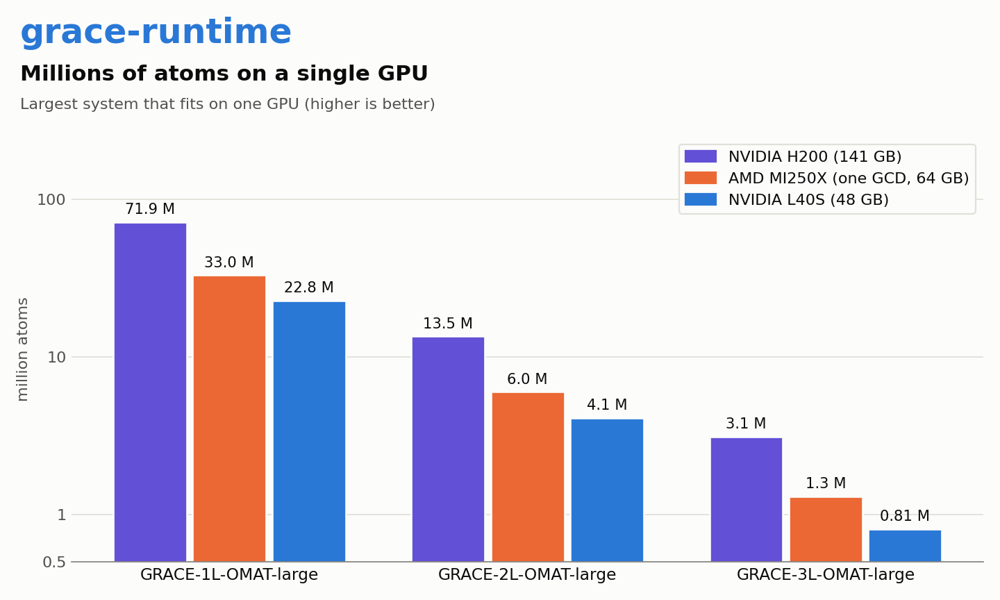

# Benchmarks

How fast grace-runtime evaluates the GRACE foundation models, and how many atoms fit on one GPU.

## How we measured

| | |
|---|---|
| Models | GRACE-1L-OMAT-large-base, GRACE-2L-OMAT-large-base, GRACE-3L-OMAT-large (cutoff 6 Å) |
| System | bcc crystal (a = 3.165 Å) with 25 elements (Al to Os) in random order, atoms displaced by about 0.02 Å; about 58 neighbours per atom |
| Calculation | `GRACERuntimeCalculator` with default settings; each call computes energy, forces and stress |
| Time per atom | median of 3 calls after the first; the lowest value over system sizes from about 1000 atoms up. It changes little above about 16000 atoms (GPU) or 2000 atoms (CPU). H200: lowest of 31,250 and 128,000 atoms |
| Largest system | double the number of atoms until a structure does not fit the GPU memory, then bisect; the largest structure that runs, each size in a new process |
| GPUs | NVIDIA H200 NVL 141 GB, NVIDIA L40S 48 GB, AMD Instinct MI250X: one GCD (half of the card) with 64 GB |
| CPU | Intel Xeon Gold 6526Y (16 cores per socket); 16 threads on one socket (`OMP_NUM_THREADS`) |
| Software | grace-runtime 0.1 wheels from PyPI (`grace-runtime`, `grace-runtime-cuda12`, `grace-runtime-rocm6`) |
